<div align="center">




[](https://www.linkedin.com/in/ahmed-akremi-8810a323b/)
[](mailto:ahmedakremi42@gmail.com)


</div>

---

### 🖥️ System Boot Log

```bash
[OK] Loading identity matrix ...... Ahmed Akremi — Full Stack & Mobile Developer
[OK] Education .................... Bachelor's in ICT @ ISITCOM Hammam Sousse (2024 – 2027)
[OK] Field experience ............. 3 internships @ Designet Web Agency (Laravel · AI · Angular + Spring Boot)
[OK] Business module .............. Sales Representative @ Designet Web Agency
[OK] Security clearance ........... Cisco Networking Academy — Ethical Hacker, Junior Cybersecurity Analyst
[OK] Mission directive ............ "Turning ideas into real applications, one line of code at a time."
[READY] All systems nominal. Awaiting instructions, sir.
```

- 💻 **Primary directive:** full stack web and mobile apps, from the REST API to the screen in your hand.
- 🧠 **AI module:** CNNs, predictive models and local LLM services that solve a real problem.
- 🛡️ **Defense grid:** ethical hacking and network security, done only on authorized targets.
- 🤝 **Business interface:** I also sell digital projects, so I know what the client actually needs before I write the code.

---

### 🚀 Mission Archive (Featured Projects)

<table>
<tr>
<td width="50%" valign="top">

#### 🏋️ [Fitness League](https://fitness-league-rho.vercel.app)
A mobile app that turns training progress into a fair, competitive game, rewarding progress, consistency and verified effort. A monorepo with an API, an admin panel and a trilingual (EN/FR/AR) landing page.

`React Native` `NestJS` `PostgreSQL` `Rust` `Docker`

🔗 [Live demo](https://fitness-league-rho.vercel.app) · 🔒 private repo

</td>
<td width="50%" valign="top">

#### 🧾 [TunisiaInvoice](https://github.com/Ahmed-Akremi/loigiciel-de-factorisation-tunisie)
Offline-first invoicing and sales software for Tunisian businesses: configurable VAT, fiscal stamp and withholding tax, a first-run wizard, backup/restore, a Windows installer and 64 automated tests.

`Electron` `React` `TypeScript` `Prisma` `libSQL`

</td>
</tr>
<tr>
<td width="50%" valign="top">

#### 🛰️ [Recon Pentest Platform](https://github.com/Ahmed-Akremi/recon-pentest-platform) + [AI Service](https://github.com/Ahmed-Akremi/ai_service)
A Laravel platform for authorized reconnaissance. It runs subdomain, port and directory discovery as background jobs and normalizes findings by severity. Its companion, a Flask API on a local Ollama LLM, handles defensive analysis.

`Laravel` `Nmap` `Subfinder` `Gobuster` `Flask` `Ollama`

</td>
<td width="50%" valign="top">

#### 🎓 [SmartLMS](https://github.com/Ahmed-Akremi/SmartLMS)
A learning management platform with courses, chapters, categories, instructors and students, plus payment tracking, certificates and an admin dashboard, on a clean MVC architecture.

`Laravel` `Blade` `PHP` `MySQL`

</td>
</tr>
<tr>
<td width="50%" valign="top">

#### 🧠 [Facial Emotion AI + Leo](https://github.com/Ahmed-Akremi/reconnaissance-faciale)
A CNN that classifies 7 emotions from 48×48 face images, paired with Leo, a chatbot that analyzes sensor events, scores suspicious movements and tracks session stats.

`TensorFlow` `Keras` `OpenCV` `scikit-learn`

</td>
<td width="50%" valign="top">

#### 🎯 [Plan vs Instinct](https://github.com/Ahmed-Akremi/Plan-vs-Instinct-Decision)
A deep learning model that predicts *follow the plan* or *improvise* from 5 variables (risk, trust, time pressure, chaos, plan integrity). It scores **97.4% accuracy** on 1,000 test samples.

`Python` `Deep Learning`

</td>
</tr>
</table>

<details>
<summary><b>📂 More missions</b></summary>

<br/>

| Project | What it does | Stack |
|---|---|---|
| [Predict Next Guard Action](https://github.com/Ahmed-Akremi/predict-next-guard-action) | Random Forest that predicts a guard's next move from action sequences, with an interactive CLI | Python · scikit-learn |
| [Mini LMS for Android](https://github.com/Ahmed-Akremi/mobileApp-isitcom) | Student/instructor roles, sessions, course CRUD and search, stored locally | Java · Android · SQLite |
| [Weather App](https://github.com/Ahmed-Akremi/weather-app) | Current conditions with hourly and daily forecasts | Java · Android · REST API |
| [Job Offers Platform](https://github.com/Ahmed-Akremi/offre-d-emploi-frontend) | Frontend for a job offers platform, built during my full stack internship | Angular · TypeScript |
| [Lost & Found](https://github.com/Ahmed-Akremi/lost-and-found) | Report, search and recover lost items from a personal dashboard | PHP · MySQL |

</details>

---

### 🛠️ Suit Systems (Tech Arsenal)

<table>
<tr><td><b>🎨 Frontend</b></td><td></td></tr>
<tr><td><b>⚙️ Backend & Data</b></td><td></td></tr>
<tr><td><b>📱 Mobile & Desktop</b></td><td> <sub>Java (Android) · React Native + Expo · Electron</sub></td></tr>
<tr><td><b>🧠 AI & ML</b></td><td> <sub>Keras · NumPy · Ollama</sub></td></tr>
<tr><td><b>🛡️ Security & Networks</b></td><td> <sub>Nmap · Subfinder · Gobuster · Cisco Packet Tracer</sub></td></tr>
<tr><td><b>🧰 Tools</b></td><td> <sub>Agile</sub></td></tr>
</table>

---

### 🛡️ Security Clearances (Certifications)

| Issuer | Certification | Date |
|---|---|---|
| Cisco Networking Academy | Junior Cybersecurity Analyst Career Path | Dec 2023 |
| Cisco Networking Academy | Introduction to Cybersecurity | Dec 2023 |
| Cisco Networking Academy | Python Essentials 1 | Dec 2023 |
| Cisco Networking Academy | Ethical Hacker | Oct 2023 |
| Cisco Networking Academy | Cybersecurity Essentials | Oct 2023 |
| Designet Web Agency | Training: Angular & Spring Boot · AI · Laravel | 2024 – 2026 |

---

<div align="center">

### 📊 Diagnostics Report


</div>

---

### ⚡ System Log: Fun Fact

```bash
> query fun_fact.exe
[OUTPUT] I pitch digital projects to clients by day and build them by night.
[OUTPUT] No Stark Industries budget required — just coffee, curiosity and 2 AM debugging sessions.
[STATUS] Confirmed: qualifies as a personality trait.
```

---

<div align="center">

### 📡 Open Channel

Have an internship, a job or a project in mind? I'm open to opportunities in the Sahel, Greater Tunis and abroad.<br/>
**[ahmedakremi42@gmail.com](mailto:ahmedakremi42@gmail.com)** · **[LinkedIn](https://www.linkedin.com/in/ahmed-akremi-8810a323b/)**


```bash
[SYSTEM] End of transmission.
[SYSTEM] Standing by for further instructions.
```

</div>
